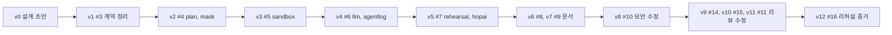

# 버전 히스토리

main에 들어간 순서대로 ai-sandbox가 어떻게 자랐는지 정리했습니다. 이 레포는 화면이 없어서, 버전마다 **무엇이 생겼는지, 어떤 패키지가 있었는지, 무엇으로 확인했는지**를 적었습니다. "테스트 함수"는 그 머지 커밋의 `func Test…` 개수입니다(표 안의 하위 사례는 따로 세지 않음).

| 버전 | PR | 머지 (KST) | 작성 | 종류 | 패키지 | 테스트 함수 | 한 줄 요약 |
| --- | --- | --- | --- | --- | --- | --- | --- |
| [v0](#v0--설계-초안) | 직접 커밋 | 11/2 10:06 | 이태훈 | 문서 | - | 0 | AI·샌드박스 설계 초안 |
| [v1](#v1--pr-3-engineplan-계약에-맞춘-설계-문서) | [#3](https://github.com/2026-Softbank-Hackathon-Charlie/ai-sandbox/pull/3) | 11/2 16:27 | 김동윤 | 문서 | - | 0 | 설계 문서를 플랫폼 EnginePlan 계약에 맞춤 |
| [v2](#v2--pr-4-엔진-plan과-대상-매니페스트-검사) | [#4](https://github.com/2026-Softbank-Hackathon-Charlie/ai-sandbox/pull/4) | 11/2 18:39 | 이태훈 | 기능 | 2 | 14 | AI 계획 검사 (`plan`, `mask`) |
| [v3](#v3--pr-5-샌드박스-생성삭제와-격리-검증) | [#5](https://github.com/2026-Softbank-Hackathon-Charlie/ai-sandbox/pull/5) | 11/2 18:44 | 이태훈 | 기능 | 4 | 28 | 샌드박스와 격리 검사 (`sandbox`, `sandboxctl`) |
| [v4](#v4--pr-6-도구를-쓰는-ai-에이전트와-세션-기록) | [#6](https://github.com/2026-Softbank-Hackathon-Charlie/ai-sandbox/pull/6) | 11/2 18:49 | 이태훈 | 기능 | 6 | 40 | 도구를 쓰는 AI 에이전트와 기록 (`llm`, `agentlog`) |
| [v5](#v5--pr-7-실제-엔진-리허설과-hopai) | [#7](https://github.com/2026-Softbank-Hackathon-Charlie/ai-sandbox/pull/7) | 11/2 18:52 | 이태훈 | 기능 | 8 | 52 | 실제 엔진 리허설과 전체 흐름 (`rehearsal`, `hopai`) |
| [v6](#v6--pr-8-구현-내용을-설계-문서에-반영) | [#8](https://github.com/2026-Softbank-Hackathon-Charlie/ai-sandbox/pull/8) | 11/2 18:54 | 이태훈 | 문서 | 8 | 52 | 1~4번 구현을 README에 반영 |
| [v7](#v7--pr-9-maxdowntime-설명-정리) | [#9](https://github.com/2026-Softbank-Hackathon-Charlie/ai-sandbox/pull/9) | 11/2 19:05 | 이태훈 | 문서 | 8 | 52 | `maxDowntime`을 쓰기 보류 시간으로 정리 |
| [v8](#v8--pr-10-ai-출력-검사의-보안-구멍-3개) | [#10](https://github.com/2026-Softbank-Hackathon-Charlie/ai-sandbox/pull/10) | 11/2 19:53 | 이태훈 | 보안 수정 | 8 | 53 | 복제 출처, 이미지, 샌드박스 탈출 막기 |
| [v9](#v9--pr-14-ai-plan-입력과-합성-데이터-검증의-빈틈) | [#14](https://github.com/2026-Softbank-Hackathon-Charlie/ai-sandbox/pull/14) | 11/2 20:32 | 김동윤 | 수정 | 8 | 65 | 상한값 필수, 비밀값 가리기, 합성 데이터 검증 증거 |
| [v10](#v10--pr-15-리허설-결과와-cli-종료-일치) | [#15](https://github.com/2026-Softbank-Hackathon-Charlie/ai-sandbox/pull/15) | 11/2 20:40 | 김동윤 | 수정 | 8 | 73 | 실행 결과와 기록·정리 결과 분리, CLI 종료 코드 |
| [v11](#v11--pr-11-리뷰-나머지-4건) | [#11](https://github.com/2026-Softbank-Hackathon-Charlie/ai-sandbox/pull/11) | 11/2 20:45 | 이태훈 | 수정 | 8 | 75 | 격리 증거, 수정안 업로드 조건, 비밀번호 가리기, 긴 네임스페이스 |
| [v12](#v12--pr-16-리허설-리포트에-후보-digest) | [#16](https://github.com/2026-Softbank-Hackathon-Charlie/ai-sandbox/pull/16) | 11/3 11:19 | 이태훈 | 기능 | 8 | 78 | 승인 게이트용 리허설 증거 (platform #24) |

- 닫힌 PR: #1(Plan JSON 스키마 검사와 재요청), #2(샌드박스 생성·삭제)는 엔진 Plan 계약이 정해진 뒤 #4~#8로 다시 나눠 올렸습니다.
- 이슈 #12, #13은 각각 #14, #15로 닫혔습니다.



---

## v0 · 설계 초안

커밋 `02212f4` · 이태훈 · 11/2 10:06 · README 164줄

D 영역(AI·샌드박스)의 설계 초안입니다. AI는 계획과 수정안만 만들고 운영을 바꾸는 권한은 엔진에만 둔다는 원칙, Plan 검사, 도구 허용 목록, 샌드박스 격리, 리허설, 데모 실패 시나리오를 처음 적었습니다. 이때의 Plan 예제는 `app/from/to/steps` 모양이었습니다.

---

## v1 · PR #3: EnginePlan 계약에 맞춘 설계 문서

머지 커밋 `87a4981` · 김동윤 · 11/2 16:27 · README +97 −31

설계 문서의 Plan 예제를 실제 플랫폼 `EnginePlan` 계약(`id`, `source`, `target`)으로 바꿨습니다.

- 초안 요청 `PlanDraftRequest`와 제출 본문 `EnginePlan`을 나눴습니다.
- Plan의 단계 배열을 없애고, 엔진의 고정 9단계와 플랫폼의 카나리·전환 승인 위치를 설명했습니다.
- Plan ref, 매니페스트 첨부, 승인 revision, 쓰기 기록 스트림, 에이전트 활동 기록 API를 정리했습니다.
- **확인:** README의 JSON 예제를 실제 OpenAPI 스키마로 검증하고, 잘못된 입력 9개가 거부되는 것을 확인했습니다.

---

## v2 · PR #4: 엔진 Plan과 대상 매니페스트 검사

머지 커밋 `4743538` · 이태훈 · 11/2 18:39 · 14파일 +1,100 · 패키지 `plan`, `mask`

AI가 내는 계획을 **엔진 Plan(migration-engine `pkg/plan`) + 대상 CNPG 매니페스트 + 근거**로 받아 검사합니다. 작은 PR 5개 중 1번입니다.

- **초안과 같아야 하는 값:** id, source 전체, target의 env·context·namespace·cluster·dsn, gateway, 파일 위치, 검증 스키마·쓰기 기록. AI가 DSN이나 게이트웨이를 다른 곳으로 돌리지 못하게 합니다.
- **고정 규칙:** fence 비교(`verify.fenceGate`)는 끌 수 없고, `target.manifest`는 비우거나 `attachment:target.yaml`이어야 합니다. 상한값에는 범위가 있습니다(maxDowntime 5s~60s 등).
- **매니페스트:** CNPG Cluster 하나, 이름·네임스페이스가 Plan과 같아야 하고, 엔진의 분산 토폴로지(`replica.primary`·`replica.source` = 원본), `pg_basebackup` 시작만 받습니다. 슈퍼유저·백업 대상 같은 키는 거절합니다.
- **진단 수정안:** `manifest-patch`(StorageClass, 크기, 자원, 인스턴스, 이미지)와 `plan-param`(상한값, 검증 테이블)만 받고, 사본에 적용한 뒤 모든 검사를 다시 통과해야 합니다.
- `mask`: AI에 보내기 전에 비밀값을 가립니다.
- **확인:** 형식이 깨진 AI 응답(코드 블록, 끊긴 JSON, 뒤에 붙은 설명)과 규칙을 어긴 응답(대상 DSN 바꾸기, fence 끄기, 슈퍼유저 키) 테스트.

---

## v3 · PR #5: 샌드박스 생성·삭제와 격리 검증

머지 커밋 `214b956` · 이태훈 · 11/2 18:44 · 7파일 +1,493 · 패키지 `sandbox`, `cmd/sandboxctl` 추가

리허설용 샌드박스를 만들고 지우고, 격리가 실제로 되는지 검사합니다.

| 리소스 | 내용 |
| --- | --- |
| 네임스페이스 | `sandbox-<앱>-<4자리>`, 라벨 `hopcharlie/sandbox=true`, 만료 시각(기본 1시간) |
| NetworkPolicy | 기본 전부 차단, 같은 네임스페이스와 kube-dns만 허용. 네임스페이스 바로 다음에 만듦 |
| ResourceQuota, LimitRange | CPU 4, 메모리 8Gi, Pod 20개, LoadBalancer·NodePort 0개 |
| AI 계정 Role | 자기 네임스페이스 안에서만. NetworkPolicy·Role·토큰 생성·exec 권한 없음 |

- 삭제는 이름(`sandbox-`)과 라벨이 둘 다 맞을 때만 합니다. 토큰은 1시간짜리이고, 만료 정리(`Sweep`)가 있습니다.
- **CNPG 모드:** 오퍼레이터가 들어오는 길과 API 서버로 나가는 길만 더 엽니다.
- **격리 검사:** AI 토큰으로 운영 Secret 읽기, 자기 NetworkPolicy 삭제, Role 수정, 토큰 생성, 운영 Deployment 삭제, 메타데이터 주소·API 서버·운영 DB 접속을 시도해 모두 막히는지 봅니다.
- **확인:** 로컬 kind(CNPG 1.25.1)에서 일반·CNPG 모드 10개 항목이 기대대로 나왔고, 정책 없는 네임스페이스(대조군)에서는 같은 대상이 열렸습니다.

---

## v4 · PR #6: 도구를 쓰는 AI 에이전트와 세션 기록

머지 커밋 `5881e14` · 이태훈 · 11/2 18:49 · 13파일 +1,664 · 패키지 `llm`, `agentlog` 추가

- **에이전트:** Claude API Go SDK의 Tool Runner로 도구 호출을 반복합니다. 모델 `claude-opus-5-5`, 생각 깊이 `medium`, 안전 분류기 거절 시 대체 모델(`fallbacks: "default"`).
- **응답 검사 두 겹:** API에 JSON 스키마를 넘겨 형식을 강제하고, 받은 뒤 v2의 검사를 다시 돌립니다. 걸리면 대화를 이어 다시 묻습니다(2회). 거절·잘림·오류·타임아웃은 다시 묻지 않습니다.
- **계획 도구 (모두 읽기 전용, Secret 도구 없음):** `get_app`, `list_storage_classes`, `node_capacity`, `get_cnpg_cluster`. 범위 밖 요청은 도구 안에서 막고 `blocked`로 남깁니다.
- **진단:** 리허설 실패 로그(가린 뒤)와 도구로 원인, 근거, 수정안을 냅니다.
- **기록 (`agentlog`, platform ADR 0008):** 작업마다 `/v1/agent/sessions`로 세션을 열고 `tool_call`, `tool_result`, `blocked`, `message`(토큰, 시간), `error`, `decision`을 남깁니다. 콘솔의 'AI 활동'과 `charlie agent watch`에서 실시간으로 보입니다. 기록은 에이전트 코드가 남기므로 AI가 고치거나 빼먹을 수 없습니다.

---

## v5 · PR #7: 실제 엔진 리허설과 hopai

머지 커밋 `552ad0a` · 이태훈 · 11/2 18:52 · 12파일 +1,721 · 패키지 `rehearsal`, `cmd/hopai` 추가

승인 전에 대상 클러스터의 샌드박스에서 **실제 migration-engine**으로 Plan을 끝까지 돌립니다(본선 규칙: 고정값을 돌려주는 단계 없음).

1. 샌드박스(CNPG 모드)를 만들고 격리 검사를 돌립니다. 격리가 깨지면 전체를 멈춥니다.
2. 임시 원본 CNPG를 만들고 테스트 데이터를 넣습니다. 운영 데이터는 넣지 않습니다.
3. AI가 쓴 대상 매니페스트를 샌드박스로 옮깁니다. StorageClass·크기·자원·인스턴스·이미지는 그대로 둡니다.
4. 엔진 9단계를 라이브러리로 실행합니다. 쿠버네티스는 샌드박스 토큰으로, DB는 연결마다 primary Pod로 port-forward하는 프록시로 붙습니다.
5. 같은 경고가 25초 넘게 되풀이되면 엔진을 멈추고 근거로 남깁니다.
6. 실패하면 AI가 진단하고, 수정안을 사본에 적용해 새 샌드박스에서 다시 돌립니다(최대 3회).

`hopai run`: Plan 초안 → AI 계획 → 제출과 `target.yaml` 첨부 → 리허설 → 고친 매니페스트와 `rehearsal-report.json` 첨부 → 운영자 승인.

| 확인 (PR 본문 기준, 로컬 kind, CNPG 1.25.1) | 결과 |
| --- | --- |
| 대상 StorageClass `standard` | 격리 검사 10/10 → 엔진 9단계 모두 성공, 쓰기 보류 8.8초, 전체 80초 |
| 대상 StorageClass `gp3` (kind에 없음) | prepare에서 52초 만에 멈춤, 근거 `storageclass "gp3" not found`, 원본 그대로 |

확인하면서 port-forward(연결마다 따로), 복제 인증서 시크릿, DSN의 `${VAR}` 해석을 고쳤습니다.

---

## v6 · PR #8: 구현 내용을 설계 문서에 반영

머지 커밋 `8797710` · 이태훈 · 11/2 18:54 · README +169 −60

v2~v5에서 구현한 내용을 설계 문서에 반영했습니다. v1(#3)의 계약 설명은 그대로 두고, 2장(전체 흐름), 3장(검사 규칙 표), 4~5장(에이전트, 기록, 도구), 6장(CNPG 모드, 격리 항목), 7·9·10장(리허설, 데모 실패, 날짜별), 11장(팀 결정), 12장(구현 현황, 실행 방법, kind 결과)을 고쳤습니다.

---

## v7 · PR #9: maxDowntime 설명 정리

머지 커밋 `1850ee5` · 이태훈 · 11/2 19:05 · README +4 −3

`maxDowntime`이 서비스 중단 시간으로 읽히지 않게 **쓰기 보류 시간**의 예산이라고 풀어 썼습니다. 상한 60초는 게이트웨이의 쓰기 보류 한도(90초)보다 짧게 잡은 것이라는 이유를 적고, 검사 범위 밖이던 예제 값 `3m`을 `30s`로 바꿨습니다.

---

## v8 · PR #10: AI 출력 검사의 보안 구멍 3개

머지 커밋 `45f7e6e` · 이태훈 · 11/2 19:53 · 9파일 +268 −13

모두 AI가 낸 값이 검사를 통과해 운영이나 샌드박스 밖에 영향을 줄 수 있던 경우입니다.

| 문제 | 수정 |
| --- | --- |
| 매니페스트의 `externalClusters`·`pg_basebackup`으로 다른 DB에서 복제할 수 있었음 | 원본·대상 이름만, host·port는 Plan DSN과 같게, user는 `streaming_replica`, 인증서 시크릿 이름 고정 |
| `spec.imageName`에 아무 이미지나 쓸 수 있었음 | `ghcr.io/cloudnative-pg/postgresql:<버전>`(digest 고정 포함)만 받음 |
| AI 계정이 hostNetwork·hostPath Pod로 샌드박스를 벗어날 수 있었음 | 네임스페이스에 Pod Security `baseline`을 걸고, 격리 검사에 `host-pod-create` 항목 추가 |

---

## v9 · PR #14: AI Plan 입력과 합성 데이터 검증의 빈틈

머지 커밋 `8afdd5c` · 김동윤 · 11/2 20:32 · 13파일 +602 −41 · 이슈 #12 닫음

- fenceGate 기본값과 상한값 네 개 필수를 보장하고, 기존 테이블 검증 범위를 줄이지 못하게 했습니다.
- 비밀값 가리기가 JSON 구조와 `${VAR}`를 망가뜨리지 않게 고쳤습니다. 가린 초안과 비교한 뒤 원래 값을 되돌리고, 재요청 오류에도 비밀값을 남기지 않습니다.
- 리허설은 합성 데이터(fixture)를 명시적으로 고르고, 엔진의 fence 비교와 전환 후 검증 증거에서 모든 표와 양수 행 수를 확인해야 통과합니다(`rehearsal/coverage.go`).

---

## v10 · PR #15: 리허설 결과와 CLI 종료 일치

머지 커밋 `6c9a1dc` · 김동윤 · 11/2 20:40 · 7파일 +358 −32 · 이슈 #13 닫음

- 실행·데이터 검증의 `passed`는 그대로 두고, 기록과 정리 실패는 가린 `warnings`로 따로 보여 줍니다.
- 각 시도의 `cleanup.status`에 `delete_requested` 또는 `failed`를 남깁니다. 삭제 요청 수락을 삭제 완료로 보지 않습니다.
- 취소돼도 정리와 세션 종료를 별도 제한 시간 안에 시도합니다.
- CLI는 경고를 출력하고 리포트와 같은 판정으로 종료합니다.

---

## v11 · PR #11: 리뷰 나머지 4건

머지 커밋 `554799f` · 이태훈 · 11/2 20:45 · 8파일 +81 −21

| 문제 | 수정 |
| --- | --- |
| 격리 검사의 증거 대상(API 서버, CNPG 웹훅)을 못 찾아도 '막힘'으로 기록됨 | 증거 대상은 먼저 찾고, 못 찾으면 검사 실패 |
| 리허설에 실패해도 수정안을 첨부·재제출함 | 리허설을 통과했을 때만 올림. 리포트는 늘 첨부 |
| DSN 비밀번호 가리기가 빈 사용자 이름과 `@`가 든 비밀번호를 놓침 | 정규식을 넓힘 |
| 원본 네임스페이스가 길면 샌드박스 생성이 실패함 | 앞 27자 + 해시 4자리로 줄임 |

v9·v10과 같은 파일을 고쳐 충돌이 났고, main을 합쳐 풀었습니다(force push 없음).

---

## v12 · PR #16: 리허설 리포트에 후보 digest

머지 커밋 `2f6970e` · 이태훈 · 11/3 11:19 · 7파일 +200 −14 · platform #24의 ai-sandbox 쪽

리허설 리포트가 **어느 후보(Plan 본문 + 대상 매니페스트)를 리허설했는지** 해시로 남깁니다. 플랫폼 승인 게이트가 저장된 Plan과 첨부의 해시와 비교합니다.

```json
{
  "schemaVersion": "hopcharlie.rehearsal/v1",
  "passed": true,
  "candidate": { "planSha256": "…", "manifestSha256": "…" },
  "attempts": [ { "candidate": { "…": "…" }, "coverage": { "…": "…" } } ]
}
```

- `planSha256`은 `POST /v1/plans`로 보낸 본문 바이트의 SHA-256, `manifestSha256`은 `target.yaml` 첨부의 SHA-256입니다. revision은 넣지 않습니다(리포트 첨부가 revision을 올려 자기 참조가 됨).
- `hopai`는 제출과 해시에 같은 바이트를 쓰고, 리포트를 올리기 전에 플랫폼의 Plan과 첨부가 리허설한 후보와 같은지 확인합니다. 다르면 "리허설은 통과했지만 후보가 다름"으로 안내하고 종료 코드 1로 끝냅니다.
- **남은 일:** 플랫폼 쪽 승인 게이트(platform #24) 구현.
